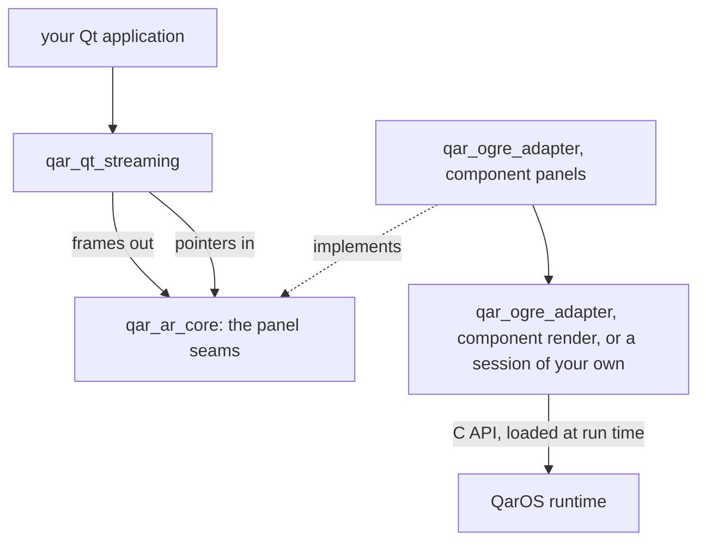
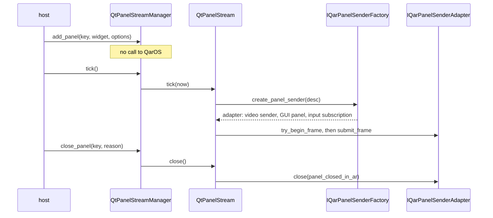
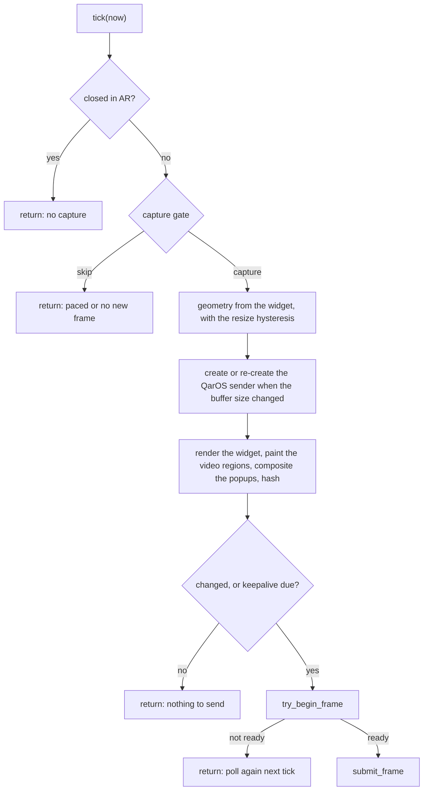
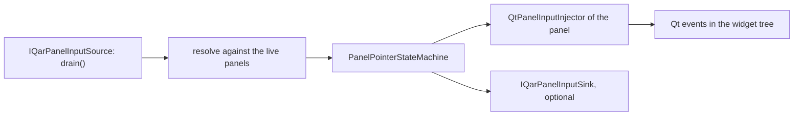

# Architecture

This page explains how the library turns a Qt widget into a QarOS GUI panel and the pointer of an operator into Qt events: which parts there are, which thread runs what, in which order the steps run, and why a few of them are the way they are. [API](API.md) lists the types and functions, and [Configuration](CONFIGURATION.md) lists the defaults.

## Where this library sits

A QarOS GUI panel is a flat rectangle that hangs in the room, and its content comes from one of two sources. With the **stream route** a program renders the content and streams it to the panel as video. With the **URL route** the panel shows a web page that the browser of QarOS loads from a URL, so QarOS renders it. This library is the stream route for Qt: it draws a widget into a pixel buffer, streams the buffer as the video of a panel, and turns the gestures that QarOS reports on the panel into Qt events. The URL route is outside this library: the component `url` of qar_ogre_adapter opens such a panel, and the libraries of qar_rviz_plugin serve the pages.



The library never calls the QarOS C API. Everything that reaches QarOS crosses two interfaces that `qar_ar_core` of qar_ogre_adapter defines: `IQarPanelSenderFactory` and `IQarPanelSenderAdapter` take the frames out, and `IQarPanelInputSource` brings the pointer samples in. The component `panels` implements them, as `QarCApiPanelSenderFactory` and `QarCApiPanelInputSource`, on top of a QarOS session. The component `render` opens that session with `QarCApiSenderFactory`, and a program that opens its own session implements `IQarSessionOwner` instead. A GUI panel and its video sender have to belong to the same session, which is why the panel factory borrows the session of its owner and never creates one.

The library itself knows Qt and the seams and nothing else. It links Qt Core, Gui and Widgets and the module `qar_ar_core`, it has no dependency on Ogre, RViz, ament or ROS, and the layering guard fails the build when one of its files includes anything beyond the standard library, Qt, its own headers and `qar_ar_core`. The seams carry no Qt type, so that qar_ogre_adapter implements them without a Qt dependency, and the values that cross them are the types of the QarOS C header, `QarPose`, `QarVector3` and `QarGuiPanelSize`, so that nothing converts them on the way.

## Components

| Part | What it does | Headers |
|---|---|---|
| `QtPanelStreamManager` | owns one stream for each widget; one `tick()` drives them all; drains the input source, resolves each sample against the panels, runs the pointer state machine and hands the actions to the injectors; gives dialogs panels of their own; closes panels | `qt_panel_stream_manager.hpp` |
| `QtPanelStream` | one widget as one panel: geometry, creation and re-creation of the QarOS sender, pacing, keepalive, the accounting of the panel and its injector | `qt_panel_stream.hpp` |
| `QtWidgetCapture` | draws the widget into a reused RGBA8888 buffer, paints video over regions that Qt cannot draw, composites popups, hashes the picture | `qt_widget_capture.hpp` |
| the capture gate | decides whether a tick may capture | `capture_gate.hpp` |
| `QtPanelInputInjector` | delivers pointer actions to the widget tree as Qt events | `qt_panel_input_injector.hpp` |
| the pointer state machine | turns gesture samples into enter, move, press, drag, release, click, leave and cancel | `panel_pointer_state.hpp` |
| the hit test | maps a point or a ray in the room to a position on a panel and chooses the panel | `panel_hit_test.hpp` |
| geometry and readability | the size of the buffer and of the panel, and the size of a pixel for a viewing distance | `panel_geometry.hpp`, `ar_readability.hpp` |
| close mode and notice | what closing a window does to its panel, and the notice of the second mode | `panel_close_mode.hpp`, `panel_tombstone.hpp` |
| off-screen panels | a widget that is shown to Qt only, and the guard for its popups | `offscreen_panel.hpp`, `offscreen_popup_guard.hpp` |
| video | decoding, the one-slot mailbox and the widget that shows a frame | `video_frame.hpp`, `latest_video_frame.hpp`, `video_panel_widget.hpp` |
| `IClock`, `SteadyClock` | the time source of the pacing, which a test replaces | `clock.hpp` |

The headers `panel_geometry.hpp`, `ar_readability.hpp`, `panel_hit_test.hpp`, `panel_pointer_state.hpp`, `capture_gate.hpp` and `panel_close_mode.hpp` are plain C++ that needs no `QApplication`, and so is the parser of `offscreen_panel.hpp`; their unit tests run without a widget. The rest needs Qt Widgets and the GUI thread.

The library uses four seams that other code supplies. A seam is an abstract interface that one module defines and another implements, so that the dependency points the right way and a test can replace the code behind it.

| Seam | Defined in | Implemented by | What crosses |
|---|---|---|---|
| `IQarPanelSenderFactory`, `IQarPanelSenderAdapter` | `qar_ar_core/qar_panel_sender.hpp` | `QarCApiPanelSenderFactory`, `QarCApiPanelSenderAdapter` of the component `panels`; a recording double in the tests | frames out: `try_begin_frame`, `submit_frame`, `set_placement`, `close` |
| `IQarPanelInputSource` | `qar_ar_core/panel_input_source.hpp` | `QarCApiPanelInputSource` of `panels`; `QueuedPanelInputSource` | pointer samples in, and the keys of the panels that the operator closed in AR |
| `PanelDiagnosticsSink` | `qar_ar_core/panel_types.hpp` | the host | the lines of the manager, with a severity, a category and the key of the panel |
| `IQarPanelInputSink` | `qt_panel_stream_manager.hpp` | the host, optional | the coarse result of the input: which panel, which pixel, a hover or a click |

The header-only target `qar_qt_streaming_test_support` holds the recording stand-ins that the unit tests use; it is separate, so that it does not ship with the library. [Testing](TESTING.md#test-doubles) describes them.

## Thread model

Everything runs on the Qt GUI thread, the one thread that may paint a widget or receive input for one. Two facts make that possible. `QWidget::render()` runs the paint path of a widget, which Qt permits only on the GUI thread, so the capture has no choice about where it runs. And `try_begin_frame` never blocks: it reports `ready == false` while no receiver has reserved a destination, so the whole capture and submit chain fits in a timer on the GUI thread, with no executor, no render lock and no hand-over of work between threads; the only locks are the mutex of the queue of the input source and the mutex of the video mailbox, each held for a moment. The stereo path of qar_ogre_adapter needs all three; its ARCHITECTURE explains why under "Threading model".

| Thread | What runs there | Rule |
|---|---|---|
| Qt GUI thread | every method of `QtPanelStreamManager` and `QtPanelStream`, the capture, the delivery of input, the diagnostics sink, the close of a panel | the only thread that touches a widget; the injector refuses a delivery from any other thread and counts it as dropped; the sink must not block |
| callback threads of QarOS | the callbacks of the input source | they only queue samples; `drain` hands the queue to the GUI thread, and the mutex of that queue is the one lock of the input path |
| decode worker, optional | the decoders of `video_frame.hpp`, then `LatestVideoFrame::publish` | the decoders touch only `QImage`, so they are safe off the GUI thread; the mailbox holds one mutex and the GUI thread only reads |
| the thread that opens the session | the constructor of `QarCApiSenderFactory`, which blocks while QarOS starts | not a job of this library: connect before any window is shown or on a worker thread; `add_panel` calls QarOS never |

The frame path never waits for QarOS, but two other things do run synchronously on the GUI thread: the creation of a panel and its close. The tick that finds a widget laid out calls `qar_video_sender_create` and `qar_gui_panels_add_panel` there, and a close calls `qar_gui_panels_close_panel` and `qar_video_sender_handle_destroy` there, and the library moves none of them to another thread. The adapter prints how long a close held the thread, so that the cost can be read from the log.

The input path keeps the rule by pulling: QarOS delivers its gesture callbacks on a thread of its own, the input source queues them there, and the GUI thread drains the queue on its next tick. [SDK compatibility](SDK_COMPATIBILITY.md#panel-input-lifecycle) says what the callbacks may and may not do.

## Ordering rules

A few orderings are not obvious, and each of them exists for a reason that a change would break.

1. **Input is pumped before capture.** A press changes what the widget looks like, so the frame that is captured on the same tick already shows it. `tick()` therefore drains the input first, unless the host pumps from a posted event ([Popups and dialogs](#popups-and-dialogs) says why a host does).
2. **The housekeeping comes before the first capture.** A tick runs the queued closes first, then the input, then the drain of the panels that the operator closed in AR, then the dialog sweep, and only then reads the clock once and ticks the streams, so that a dialog that was destroyed since the last tick never reaches a capture and every panel paces against the same instant.
3. **Pacing comes before capture.** The cap exists to save a full repaint of the widget, so a tick that the capture gate sheds does nothing else.
4. **The dirty check comes before `try_begin_frame`.** A send cycle that QarOS reserved has to be followed by a frame, so the library asks for one only when it has something to send.
5. **A resized widget gets a new sender, and the old one is closed first.** The sender and the panel are fully closed and released before the replacement is asked for, so that the runtime never holds two senders for one panel.
6. **A panel is closed in a fixed order.** The pointers that are pressed on it are released first, while the stream can still deliver; then the adapter cancels the input subscriptions, closes the QarOS panel and destroys the video sender ([Closing panels](#closing-panels)).
7. **Popups are composited after the video regions and before the hash.** An open popup then paints over the video under it, and a popup changes the hash of the picture.
8. **A panel that is not served is reported after the batch**, so that a panel that submitted on this very tick is not reported for the run that it just ended.

## Capture pipeline

A panel is created lazily, on the first tick that finds its widget laid out, and closed through the one door of the manager:



One tick of one stream runs these steps in this order, and each early exit costs nothing more:



- **The buffer.** The widget is drawn into a `QImage` of format RGBA8888 that is allocated once for each size and reused. Before each capture it is filled with transparent pixels, and the device pixel ratio is set on it, so that `QWidget::render()` paints the logical geometry of the widget into all the device pixels. The widget is drawn with its window background and its children, and a widget that is not visible gives its background and nothing else; the stream reports `widget_visible` as false then, so that a blank AR panel has a stated cause.
- **The dirty check.** After the drawing the library hashes the picture with FNV-1a, row by row so that the padding of a scanline never counts, and folds in the hashes of the video regions and of the geometry of the popups. A picture whose hash is unchanged is not sent, so an idle panel costs one repaint on each tick that passes the gate and no traffic.
- **The keepalive.** An unchanged picture is sent again after `keepalive_seconds`, 1 s by default, and a stream that has not yet submitted a frame is always due. Nothing in the C API says that a video stream needs periodic frames; the resend is defensive, because a receiver that joins in the middle of a stream would otherwise see nothing until the operator touched the panel.
- **Not ready is not an error.** When `try_begin_frame` reports no destination, the tick counts a skip and the streak of not-ready ticks and ends; the next tick asks again. A stream that stays unserved for `unserved_warn_seconds`, 5 s by default, is reported once ([Design notes](#unserved-panels-are-reported)).
- **Pacing.** A panel is captured at most `max_fps` times a second, 15 by default, because a control panel is text and buttons and every capture is a full repaint on the GUI thread.
- **Frame-driven panels.** A panel whose content is a video, a `VideoPanelWidget` or a region source, is captured on the first tick after its source published a frame, and not on a timer, unless `capture_on_frame_arrival` is switched off. The strict limiter turns a cap of 30 frames a second into about 21 when the ticks land on the 15.6 ms granularity of the Windows timer, because it needs three ticks for every frame, so the gate applies `max_fps` only as an upper bound with a tolerance of half the observed tick interval, at most half the minimum interval. A source that has been silent for two capture intervals, but at least 100 ms, puts the panel back on the strict limiter, so that the keepalive, a change of the status text and a popup are still noticed while no video arrives. A panel that is not frame-driven keeps the strict limiter unchanged.

What Qt does along the way matters in three places. A widget has to be visible for `QWidget::render()` to paint its children, and for `childAt()` to find them. A widget that has just been shown is not laid out until Qt has handled its events, which is why `add_panel` creates the QarOS panel only on the first tick that finds a size, and why the notice widget calls `ensurePolished()` and activates its layout before its first capture. And a native window that is embedded with `QWidget::createWindowContainer()` is never painted by `render()`, which [Video in panels](#video-in-panels) works around.

## DPI, buffers and AR readability

Three quantities have to agree, or a panel comes out blurry, of the wrong size, or with hover and click off target: the logical size of the widget and the device pixel ratio of Qt, and the metres of QarOS. The rule is

```text
ratio                 = devicePixelRatioF * render_scale
buffer_w              = align_up(round(logical_w * ratio), alignment)    alignment 2, at most 4096
width_meters          = logical_w * meters_per_logical_px                0.0012 by default
content_scale         = 1.0                                              always
effective_pixel_ratio = ratio, lowered when the buffer would be larger than the maximum
```

- **The physical size follows the logical pixels and never the buffer.** If it followed the buffer, a panel would double in size in the room when the operator dragged the application to a display of 200 per cent, and a denser display should make the picture sharper and not larger. The render scale is a second multiplier on the same rule: more pixels behind the same physical size.
- **Even buffer sizes.** The buffer is rounded up to an even number of pixels, because the runtime encodes panel content as video and encoders widely reject odd sizes. The slack pixels at the right and the bottom are transparent padding, and the size of the part that the widget covers is `content_width` and `content_height`: a position that comes back from QarOS is normalised against that size and not against the padded buffer.
- **The limit of 4096.** An oversized widget is not refused: the ratio is lowered until the buffer fits, so the panel keeps its physical size and streams less sharp, and `effective_pixel_ratio` says what the pixels represent.
- **`content_scale` is always 1.0.** QarOS reads the field as a zoom and not as a resolution, so the library never puts the pixel ratio into it; [Design notes](#content_scale-is-a-zoom-not-a-resolution) has the reason.
- **Input never sees buffer pixels.** A hit is a position `(u, v)` on the panel, and the conversion to widget coordinates gives logical pixels, the frame in which Qt events live, so that neither the ratio of the display nor the render scale touches the input path.
- **The default is 1.2 mm.** One logical pixel is 1.2 mm in the room unless the host says otherwise, so a panel of 500 logical pixels is 0.60 m wide.

The size of a pixel can also be derived from a viewing distance, with `ar_readability.hpp`. Legibility is angular: it is the size of the text on the retina and not on the panel, so a panel that is read from 2 m has to be larger than one read at arm's length, and it needs no more pixels, because it covers the same angle. The functions are

```text
arcmin per logical px = text_height_arcmin / (cap_height_ratio * body_font_px)
metres per logical px = viewing_distance_m * arcmin_per_logical_px * (pi / 10800)
render scale          = ceil_half(supersample * arcmin_per_logical_px / (60 / device_pixels_per_degree))
min legible font px   = body_font_px * max(16, 5 * max(1, 60 / device_pixels_per_degree)) / text_height_arcmin
```

and the defaults of the profile are the ones in the table. Each has a source in the comment of the header: normal acuity resolves about one arc-minute, the ISO 9241-303 minimum for reading is 16 arc-minutes of character height and the recommendation 20 to 22, common user-interface faces set their capitals at about 0.70 em, and an enterprise AR headset resolves about 45 pixels per degree.

| Field of `ReadabilityProfile` | Default |
|---|---|
| `viewing_distance_m` | 0.65 |
| `text_height_arcmin` | 22 |
| `device_pixels_per_degree` | 45 |
| `supersample` | 1.0 |
| `body_font_px` | 12 |
| `cap_height_ratio` | 0.70 |
| `max_render_scale` | 4.0 |

The presets `Near`, `ArmsLength` and `WallMounted` differ only in the distance: 0.40 m, 0.65 m and 2.0 m. For the arm's-length preset the arithmetic gives 2.619 arc-minutes for each logical pixel, 0.495 mm for each logical pixel, a render scale of 2.0 and a minimum legible font of 8.7 pixels, and a wall panel is five times as large as a near one and needs the same render scale. `apply_readability()` writes the metres per logical pixel and the render scale into the options of a panel, and the geometry still clamps the result to the limit of the buffer.

## Input path

A pointer sample comes from the input source and ends as Qt events in a widget:



**Samples.** A `PanelPointerSample` is either resolved already, a panel key and a position `(u, v)` from 0 to 1, or a point or a ray in the room. The first is what the per-panel subscription of QarOS delivers, and the second is what an app-volume gesture delivers; `route_room_point` and `route_room_ray` feed one implicit pointer from a point or a ray. Both end in the same state machine, and every sample is counted for its panel before anything can discard it, so that the counter answers whether anything arrived at all.

**Resolving.** A pointer that is pressed on a panel is grabbed: until its release every sample of it is projected onto the plane of that panel, outside the rectangle if need be. Otherwise the panel is the nearest one to a point, or the first one that a ray hits. A sample that is resolved already goes to the panel that it names. A hit becomes a position in logical pixels of the widget, unclamped for a grabbed pointer, because Qt's implicit grab expects coordinates beyond the edge. The hit test works in panel space of QarOS, whose origin is the middle of the top edge and whose +X runs to the left of the viewer, so that content space runs backwards along both axes; [Design notes](#the-spatial-hit-test-works-in-qaros-panel-space) says why.

```text
u = 0.5 - x / width_meters          v = -y / height_meters          (x and y: the point in panel space, in metres)
```

**The state machine.** Each pointer has a state of its own, so two hands can hover two panels or press one panel. The machine turns the phases of a gesture into actions:

| Sample | Actions |
|---|---|
| hover, started, updated or instant | `Leave` of the panel left, `Enter` of the panel entered, `Move` |
| hover, ended or canceled | `Leave` (not while the pointer is pressed: the grab keeps it) |
| click or drag, started | `Press`: the panel now owns the pointer |
| click or drag, updated | `Drag`, routed to the pressed panel, `inside` false beyond its edge |
| click or drag, ended | `Release`, then `Click` when the pointer is still over the panel |
| click or drag, canceled | `Cancel`: the widget lets go and nothing is clicked |
| tap (instant) | `Press`, `Release` and `Click` from one sample |
| long press | counted and delivered to nobody, because Qt has no long-press event |

A release that cannot be placed on the panel is a release outside it and so not a click, and a press that began away from every panel owns nothing, so its moves are ignored. A double click is the second press of a pair: the recogniser of QarOS counts the taps when the source reports a count, and the library clamps the count to 2, because Qt alternates and a third tap in a row is single again; without a count, two presses on the same panel within 0.4 s and 5 logical pixels on each axis are a double click, with Qt's own defaults.

**The injector.** For each action the injector finds the deepest visible child under the point with `QWidget::childAt()`, which honours masks and transparency for mouse events, maps the point into the frame of that child and sends events, directly and not through the window system:

- `Enter` and `Leave` events along the chain of widgets, counted for each widget, so that the first pointer that enters a widget sends the `Enter` and the last that leaves sends the `Leave`, and two hands over one button are one hover; `QHoverEvent` for the widgets that set `WA_Hover`; and a button-less mouse move;
- `QTouchEvent` begin, update, end and cancel, with one touch point for each pointer, grouped for the receiving widget as Qt groups the points of a touch screen;
- `QMouseEvent` press, move, release and double click, all of the left button and marked `Qt::MouseEventSynthesizedByApplication`.

Three delivery modes choose between touch and mouse. The standard controls, push buttons, sliders, line edits and tab bars, do not accept touch events, so touch alone would press nothing, and mouse alone would starve the widgets that do take touch, such as kinetic views, of the points that an AR pointer has. The default does what the platform layer of Qt does for a touch screen:

| `InputDeliveryMode` | What happens |
|---|---|
| `MouseOnly` | every pointer that can own the mouse sends mouse events; no touch |
| `TouchOnly` | touch events only; a widget without `WA_AcceptTouchEvents` gets nothing |
| `TouchWithMouseFallback`, the default | the sequence is offered as touch first; when no widget of the chain accepts the `TouchBegin`, mouse events are sent for the rest of that sequence |

Only one pointer at a time owns the synthesized mouse, because a desktop has one mouse; a further pointer that presses a plain widget meanwhile is dropped and counted with that reason, while a touch-aware widget takes it as another touch point. Why the events are not sent through `QWindowSystemInterface`, which would do the routing itself: it would share the button state, `QGuiApplication::mouseButtons()` and the popup grab with the real mouse of the desktop, so that an AR press held while the user drags with the mouse would corrupt both. The injector keeps its own implicit grab, its own enter and leave state and its own focus handling instead, and re-implements what `QApplication` does only for spontaneous events: click focus, enter and leave, the routing of events to an open popup, and the double click.

The options of `PanelInputOptions` switch these parts: `enabled`, `delivery_mode`, `deliver_hover`, `apply_focus_policy`, `route_to_popups` and `block_behind_modal`. Every widget that the injector remembers is held through `QPointer`, so that a widget destroyed in the middle of a drag drops the action instead of crashing, and `reset()` cancels the pressed pointers, leaves the hovered widgets and closes the popups that only exist in the AR picture. The sink of the manager, an `IQarPanelInputSink`, is optional: it gets a coarse hover or click with the key of the panel and the widget pixel, and only a host that wants to log or visualise the interaction needs it.

## Popups and dialogs

**Popups.** A combo box list, a menu, a completer list and a tooltip are windows of their own, so `QWidget::render()` of a panel never paints them: without more, an operator who taps a combo box in AR would see nothing happen while the list opened on the desktop behind the headset. The capture therefore composites the popups that the panel owns, in a second pass on top of the widget and its video regions.

- **Finding them.** `collect_panel_popups` returns the visible top-level windows of the kinds popup and tooltip that the panel owns, parents before children, so that a submenu paints over its menu. Ownership is a walk up `parentWidget()` to the root of the panel, and not `QWidget::isAncestorOf()`, which also demands the same window and so is false for every popup; a popup without a parent belongs to nobody, which is the safe direction, except a popup that the off-screen guard keeps off the desktop, which is followed through its focus proxy. A scan costs two static calls when nothing is popped up.
- **Placing them.** The global position of the popup goes back into panel coordinates and into device pixels at the ratio of the panel, so that a supersampled panel gets a supersampled list, and the geometry is read again on every capture, because a long list moves as it scrolls.
- **Clipping, never shifting.** A popup that hangs over the edge of its panel is cut at the edge, and `popup_clipped()` says so. Qt places a popup against the screen and not against the panel, and the input path maps a panel point to a global point and delivers it to the popup where Qt put it; drawing the popup shifted would put every item that the operator aimed at under a different one, silently. A cut list is visible, and a mis-aimed one is not. A host fixes the cut by giving the panel more room.
- **The hash.** The popups are drawn before the picture is hashed, and their geometry is part of the hash, so that opening, closing, scrolling or moving one resends the frame, also on a platform that draws no glyphs.
- **Switches.** `set_composite_popups(false)` streams the bare widget, and `set_composite_tooltips(false)` keeps lists and menus and drops the tooltips.

**Dialogs.** A dialog, a window of the kind `Qt::Dialog`, sheet or drawer, is a top-level window as well, but it is not composited. It gets a GUI panel of its own, because the rectangle of a dialog has nothing to do with the rectangle of the widget that opened it: a dialog squeezed into the narrow panel of a dock would show its top half and none of its buttons. Every `tick()` runs a sweep, before any widget is captured, that:

1. **retires** the dialog panels whose dialog is destroyed or hidden, or whose owner stopped streaming, and repeats until nothing is left to retire, because retiring a dialog panel orphans the dialog panels that it owns. Hidden counts, because `close()` and the return of `exec()` both hide. Retiring runs `close_panel`, so that the sender, the QarOS panel and the subscription go with it; one panel left behind for each dialog that was opened would exhaust the slots of the input source, which live as long as the process and are never reused;
2. **promotes** every dialog that a streamed panel owns and that has no panel yet, with `add_panel`, the entry point that a host uses, so that a dialog panel is a panel in every respect.

A dialog panel is **sized from the dialog**, and the real window is never moved or resized, except that a dialog with no size at all takes its size hint. It takes the readability, pacing and input policy of its owner. It hangs at the pose of its owner, stepped sideways in X by `dialog_panel_offset_m`, 0.5 m, once for each dialog that the owner has already, so the first is 0.5 m beside the owner and the second 1.0 m. Its key is `dialog:` and its window title, then its object name, then `Dialog`, with ` #2` and so on when the key is live, and the title is its display name. Nothing in the library knows where the operator is looking, so beside the owner is the best placement it has (see [Design notes](#dialogs-get-a-panel-of-their-own)).

**Who owns a dialog.** The parent walk answers first: a dialog parented into the tree of a streamed panel belongs to that panel. An application that parents its dialogs to its main window, as RViz does, leaves the walk without an answer, so `PanelOverlayAttribution` decides by causation: the panel that took the most recent activating AR action, a press, a release or a click and never a hover, within `window_ms` of the sighting, 1500 ms by default, owns the dialog. The decision is taken once, at the first sighting of the dialog, by the sweep and by nothing else, and it holds until the dialog hides or dies, so that input on another panel cannot move a dialog that is on screen, and a dialog object that is shown again is attributed afresh. The injector records the action before it delivers it, because delivering is what opens the dialog and `exec()` does not return until it is dismissed. A panel never takes a dialog that the parent walk gives to another panel, never takes a window that it lives in, and a dialog that the local operator opens with the mouse, without a recent AR action, has no owner: it stays on the desktop and takes no AR input.

**Modality.** Qt enforces the modality of a dialog in its platform layer and only for spontaneous events, and the injector bypasses that layer, so it reproduces the rule: while an application-modal window that the panel owns is up, the pointers on that panel reach nothing. A hover becomes a `Leave`, so that nothing behind the dialog looks hovered; a press, a drag and a release are dropped and counted with the reason `blocked by a modal dialog owned by this panel`; and `Leave` and `Cancel` always get through, so that a pointer that was already pressed when the dialog opened is let go. The dialog answers through the injector of its own panel. A popup that a dialog opens belongs to the dialog and not to its owner, so that the nearest dialog ancestor wins and a list lands in exactly one picture. `dismiss_owned_dialogs(key)` is an explicit way out: it calls `QWidget::close()` on each dialog of the panel, innermost first, which for a `QDialog` runs `reject()` as its Cancel button does, and the next sweep retires the panel.

**The re-entrancy rule.** Delivering a pointer action runs arbitrary widget code, and a button that opens a modal dialog spins a nested event loop inside `QDialog::exec()`, which does not return until the operator dismisses the dialog. If that happens inside the handler of the timer that runs the tick, Qt does not deliver that timer again while its handler is on the stack, so the tick stops, and with it every capture and every submit, for as long as the dialog is open. A host whose tick is a `QTimer` therefore sets `pump_input_in_tick` to false and calls `pump_input()` from a posted event, a queued call; a nested loop that is entered from a posted event leaves the timer free, so the stream goes on, and the next posted pump, which the nested loop delivers like any other, carries the AR clicks into the dialog. `pump_input()` is re-entrant for that reason: below the top level it works on buffers of its own. The drain of the panels that the operator closed in AR stays in `tick()`, because applying one touches no widget and so cannot enter a nested loop. A close that a handler asks for from inside a delivery is deferred until the delivery has returned.

## Resize and rebuilds

A new widget size is not a redraw. The buffer layout of a sender is fixed when it is created, and QarOS allocates the receiver of the panel from it, so a new size means a new sender, a new panel and a new subscription for the input: the old three are torn down and the new three built. Reacting to every size on the way would turn a drag of a splitter into hundreds of rebuilds, and a widget that resizes itself, such as a status label inside the streamed widget whose text grows, widens its dock, which changes the buffer, which rebuilds the panel, which rewrites the label, would rebuild the panel for ever. A size is therefore adopted only when it is **significant** and **settled**:

| Option of `PanelStreamOptions` | Default | Meaning |
|---|---|---|
| `resize_threshold_px` | 8 | a change smaller than this in both dimensions of the buffer is ignored and counted |
| `resize_settle_seconds` | 0.5 | the new size must hold for this long, on the clock that `tick` is given |
| `resize_settle_ticks` | 3 | and across this many consecutive ticks |

Until a change is adopted the panel keeps streaming at the size its sender was built for, so the captured buffer always matches the layout of the sender, and a different candidate size restarts the clock. Setting all three to zero adopts every change. The counters of the diagnostics tell the cases apart: `resizes_ignored_small` counts the changes under the threshold, `resize_pending` and the pending size show a change that is being timed, and `adapter_rebuilds` counts the senders that were built for the panel, which is 1 for a panel that has only streamed. A panel that cannot change size cannot rebuild, which is why an off-screen panel has a fixed size.

## Closing panels

The close mode of the manager, `QtPanelStreamingConfig::close_mode`, decides what happens to the AR panel of a window that closes. Every close that the Qt side starts goes through one door, `close_panel(key, reason)`: the dialog sweep, the sweep of a host for a widget that was destroyed, a Stop button, a closed dock. `remove_panel(key)` is `close_panel` without a reason.

| Event | `destroy`, the default | `notice` |
|---|---|---|
| the window closes, `close_panel`, `remove_panel`, a dialog is retired | the QarOS panel is closed, the video sender destroyed and the stream forgotten; the key is free | the stream stays and shows a notice; the sender is kept |
| the operator closes the panel in AR | capture stops; the sender goes with the close of the Qt window or the end of the session, and `qar_gui_panels_close_panel` is not called again | the same |
| the key is added again | an ordinary fresh add: a new panel on a new sender | the slot is revived onto the new widget, with the same sender, panel and title |
| the session ends: `clear()`, the destructor | every panel that is still held is closed exactly once | the same, and the only place that a sender is destroyed |

**The sequence of a close in the default mode.** (1) The pointers that are pressed on the panel are released, so that no widget stays pressed. (2) The adapter cancels the input and panel-update subscriptions of the panel. (3) The adapter closes the QarOS panel with `qar_gui_panels_close_panel`, unless the operator already closed it in AR; a failure is reported as a warning and does not stop the next step. (4) The adapter destroys the video sender. (5) The stream entry is dropped. The manager logs one line for every close, with the key, the stream, the reason, what each step did and how many frames the panel served; a panel that never served a frame, though QarOS was told its stream exists, is a warning. A close that is asked for from inside a pointer action that is being delivered into the panel itself, the Stop button of a panel that is pressed in AR, is queued: the stream is not destroyed under the handler, and the close runs when the delivery has returned, on the way out of the outermost `pump_input` or `handle_sample`, or at the top of the next tick. The call still returns success.

**The operator closes a panel in AR.** The input source reports it, the manager drains the report on every tick, and the stream stops capturing and keeps its sender: the AR side that closes a panel is not the Qt window that closes. Minimised and hidden are not a close, because the operator only put the panel away. [SDK compatibility](SDK_COMPATIBILITY.md#panel-input-lifecycle) describes the states.

**The `notice` mode** is the escape hatch for a runtime on which destroying a sender while other streams run is not safe. The stream goes on, and instead of the widget it captures an owned notice widget: parentless, `Qt::WA_DontShowOnScreen`, laid out at exactly the size of the widget that closed, so that the buffer and the sender stay as they are. The notice shows the name of the window as a headline, a rule, the reason, which is `This window has been closed, so its picture is no longer live.` when none is given, and the line `You may now close this panel in AR.`; closing the panel in AR is the operator's to do. The text is fitted by arithmetic and not by font metrics, so that it is decided in a unit test on a host with no font engine: the body size shrinks until the longest line fits 86 per cent of the width, never below the minimum legible font, and when even that does not fit, the stream reports `tombstone_clipped`. The geometry of a notice is frozen at the size of the live sender, so that a notice can never be the reason for a rebuild.

A notice holds a sender and a panel for the rest of the session, so the mode bounds them twice: **slot reuse**, because adding the key of a retired slot revives it onto the new widget and so costs no second sender, however often an operator opens and closes the same dock or dialog; and a **cap**, `max_tombstoned_panels`, 16 by default, 0 for none, beyond which no new panel stream is created, a host-requested one or a dialog, and a warning names the cap. Refusing is the only lever, because closing a sender to make room would destroy a sender in a session in which that is not safe. A stream that never created a sender is erased instead of tombstoned.

The library does not read the mode from the environment. A host chooses the mode in code, and the example reads `QAR_PANEL_CLOSE_MODE` with `parse_panel_close_mode`, a pure parser that takes the text and returns the mode, whether it was chosen, and a warning to print when the text was not a mode. The default rests on the statement of QuaternAR that the current runtime survives the destruction of a stream; [SDK compatibility](SDK_COMPATIBILITY.md#teardown-and-destroy-order) has the statement and the reasons for the other mode.

## Off-screen panels

Streaming needs a widget that is visible in the sense of Qt, and showing a top-level widget normally puts a window on the desktop. A widget whose only audience is the headset has to avoid that, and `show_offscreen(widget, width, height)` does it with `Qt::WA_DontShowOnScreen`: Qt treats the widget as mapped, so it lays out, paints, takes events and positions its popups against it, and no platform window is ever made visible. In this order:

1. it installs the popup guard, so that no popup of the widget can reach the desktop;
2. it sets `Qt::WindowDoesNotAcceptFocus` first, because changing the flags of a window hides it, so that `activateWindow()` takes no focus from the main window and the keyboard shortcuts of the widget can never fire, a shortcut working only in the active window;
3. it sets `Qt::WA_DontShowOnScreen` and clears `Qt::WA_QuitOnClose`, which Qt only ever clears on its own, so that the hidden window does not keep the application running after its main window closed;
4. it fixes the size with `setFixedSize`, each side from 200 to 2000 pixels, because a size change is a sender rebuild;
5. it moves the window to the top-left corner of the primary screen, because Qt places a popup against the screen of the widget that opens it, and a window that is parked off every screen would have its popups pulled back and composited at the wrong place; and then it shows the widget.
It returns false for a null widget and for a widget with a parent, which has no window of its own. The widget stays a plain `Qt::Window`, never a dialog, tool or popup, so that the scans for overlays can never take it for one, and `is_offscreen_panel` tells the state.

**The popups of an off-screen panel.** A popup is a window of its own, and Qt maps a window on the desktop unless that very window carries `Qt::WA_DontShowOnScreen`. A popup that is mapped is a real top-most window at the virtual position of the panel, which Qt's Windows plugin brings to the foreground and gives the mouse to, and Qt closes every popup when the application loses focus, so the list would live by desktop rules that the AR operator cannot see. The guard is one event filter on the application. On `QEvent::Polish` and `QEvent::Show`, which Qt delivers before it maps a native window, it sets `Qt::WA_DontShowOnScreen` and the property `_qar_offscreen_popup` on a popup or tooltip window that belongs to an off-screen panel; it never consumes an event. The popup stays visible to Qt, so `QApplication::activePopupWidget()` still sends the AR input to it and the capture still paints it. The menu and tooltip animation windows of Qt, found by their class names `QRollEffect` and `QAlphaWidget`, are kept off with their popup; that rests on the private class names of Qt 5.15.

A popup belongs to an off-screen panel when `popup_owner_widget`, its parent or, for a parentless popup such as the list of a `QCompleter`, its focus proxy, lives in an off-screen panel or in a popup that the guard already keeps off; the walk is bounded to 16 steps, and the popups of a visible panel are never touched. The capture and the injector place such a popup by its widget geometry, because Qt never moves the native window of a `Qt::WA_DontShowOnScreen` widget after it created it. Closing the panel, or the stream stopping, runs `close_offscreen_popups`, so that an invisible list cannot hold the application in popup mode with nobody able to reach it.

**Known limitation: dialogs.** The guard covers popups and the tooltip windows that have the panel as their parent. It does not cover dialogs, `Qt::Tool` windows or a tooltip of Qt on Windows, whose label has the desktop as its parent. A dialog that a hidden panel opens is an ordinary window: it appears on the desktop, and the manager also gives it an AR panel of its own, as for any panel. A modal dialog blocks the rest of the application, so a dialog that was hidden from the desktop could not be dismissed there, and a host would be left with a main window that waits on a window that nobody can see.

## Video in panels

A camera image has to get into a panel without the GUI thread waiting for the decoder, so the pipeline has three parts: the decoders, the mailbox and the widget that paints. A worker thread decodes the newest image and publishes it into a `LatestVideoFrame`, and the GUI thread only reads from it, in `VideoPanelWidget::paintEvent` or in the region substitution of the capture.

**Decoders.** `decode_raw_image` takes a `RawImageView`, which holds the width, the height, the step, the name of the encoding, the byte order and the data of a camera image with the field names of the ROS 2 image message, and gives an opaque RGBA8888 image, scaled down to fit a `max_size` and never up. It accepts the encodings `rgb8`, `bgr8`, `rgba8`, `bgra8`, `mono8`, `8UC1`, `8UC3`, `8UC4`, `mono16`, `16UC1`, `32FC1`, `yuv422`, `uyvy`, `yuyv` and `yuv422_yuy2`, and rejects every other with the reason `unknown encoding` and its name. The step and the size are checked against the width, the height and the encoding before a byte is read. The alpha of `rgba8` and `bgra8` is dropped. `mono16` keeps the high byte. `16UC1` is normalised for display between the smallest and the largest non-zero value, so that the zeros of a depth image render black, and `32FC1` between the smallest and the largest finite value, so that not-a-number and infinite values render black. The 4:2:2 formats convert with ITU-R BT.601 at full range, and the last column of an odd width is black. `decode_compressed_image` decodes only PNG and JPEG: the format is decided by the first bytes of the payload (the `format` string is used in messages only), and any other format is refused, whatever Qt plugins are installed. It reads the declared size of the image from its header with `QImageReader` and refuses an image that is too large before it decodes anything ([API](API.md#video-frames) gives the limits and says why the other formats are refused). The decoded image is converted to RGBA8888 and forced opaque. Both functions touch only `QImage`.

**The mailbox.** `LatestVideoFrame` has one slot. `publish` replaces the frame, counts it in `sequence()`, updates a smoothed frame rate, an exponential moving average with weight 0.2, and clears the status text, because a frame that arrives is the proof that the text has ended. A reader takes a copy of a `std::shared_ptr<const QImage>`, so that nothing is mutated while it is shared. `set_status` holds the text that a reader shows in place of a frame. When per-frame timing is on, `publish` also stores a `VideoFrameTrace` that records where the frame was on its way.

**A panel of its own.** `VideoPanelWidget` is the content of a stand-alone video panel. It is parentless, `Qt::WA_DontShowOnScreen` and shown, as the notice widget is, so that it needs no window on the desktop. It starts at the width that you pass, 640 by default, and a height of 9/16 of it. The owner calls `sync_to_frame()` once for each tick, not the paint event, because resizing inside a paint event is fragile: when the aspect ratio of the newest frame differs from that of the widget by more than 1 per cent, the height follows the frame and the width stays, and the stream takes the new size through the resize hysteresis. `paintEvent` fills the widget black, draws the frame fitted into it with the aspect ratio kept, or a dark grey fill with the status text, "Waiting for video..." when there is none, and a thin caption strip along the bottom with the title, the size of the frame and its rate.

**Video in place of a native window.** `QWidget::render()` paints a widget by walking the widget tree and calling the paint event of each child, and a native window that was embedded with `QWidget::createWindowContainer()` has no paint event that shows what the window displays, so its rectangle always comes out solid, white in practice. There is no way to make Qt render it, so the capture substitutes: `set_region_source(region, source)` registers a `LatestVideoFrame` to paint over a region, which is the widget or one of its descendants. After the ordinary render and before the popups, every registered region that is alive, visible and a descendant of the widget is filled black, and the latest frame is drawn into it, fitted with the aspect ratio kept, or a dark grey fill with the status text when there is no frame yet. A region is held through `QPointer`, so destroying it needs no call; registering a region again replaces its source, and a region of a stream whose window closed stops matching. The hash of the picture includes the rectangle and the sequence of every region, so a new frame counts as a changed picture. The manager forwards it as `set_panel_region_source` and `clear_panel_region_sources`, and the sources of a panel also drive its capture gate.

## Design notes

The notes below record why a few parts of the code are the way they are, for a reader who is about to change them. Each states the rule and what it rests on.

### content_scale is a zoom, not a resolution

The C header defines the field `QarGuiPanelSize::content_scale` as a zoom of the rendered raster: 1.0 fits the content across the full panel surface, 2.0 shows it at twice the size so that only half of it fits, and 0.5 shows it at half size, and a contact is mapped back to content pixels through it. The pixel ratio of a panel is a resolution, and a resolution sent as a zoom above 1.0 would crop the far edge of the content, so that hover and click land on the content next to the one that the operator sees. QarOS learns the resolution of the raster from the video image itself, so the library always sends 1.0, and keeps the supersample ratio in `effective_pixel_ratio` for diagnostics only; it has already done its job in the size of the buffer. A unit test pins that the value that is sent is 1.0 whatever the supersampling. [Panel pixel coordinates and content_scale](SDK_COMPATIBILITY.md#panel-pixel-coordinates-and-content_scale) states the same from the side of QarOS.

### The default metres per logical pixel is 0.0012

`kDefaultMetersPerLogicalPx` is 0.0012, which makes a panel of 500 logical pixels 0.60 m wide. It is a physical size only: the size of the buffer, the rule for the pixel ratio and `content_scale` do not depend on it, so a larger value spreads the same pixels over more metres, which is bigger text out of the same buffer at fewer source pixels for each degree. A host can decline it for a panel, or derive the value from a viewing distance with `ar_readability.hpp`.

### Panel lifetime: destroy is the default, the notice is the escape hatch

The close mode rests on one fact about the QarOS runtime, which the header of the C API does not document. QuaternAR states that the current runtime survives the destruction of a video sender while other streams run, so the default closes the panel and destroys the sender. On a runtime that does not survive it, destroying a sender while a receiver is attached leaves the receiver reconnecting, and a reconnecting receiver raises status 603 out of the frame callback of the mixer, which aborts the callback and starves every other stream that the mixer serves, the stereo 3D scene included. For such a runtime the rule is that a video sender is created once and destroyed only at the end of the session, which is what `notice` does: the stream keeps running and shows a notice. Destroying a sender is never reversible for the receiver either way, because the C API has no call that withdraws a logical stream ([Known SDK limitations](SDK_COMPATIBILITY.md#known-sdk-limitations)). Both modes close in the same order, the order of the adapter, and the AR-side close never destroys a sender.

### The C API cannot withdraw a logical video stream

`qar_video_sender_handle_destroy` returns nothing, and `qar_gui_panels_close_panel` closes the panel and not the stream behind it, so a receiver that was attached is left reconnecting and nothing on the producer side can stop it. The maintainers observed a retry about every ten seconds that failed with the status 507 until the producer peer went away. The log line of a retired stream therefore carries its stream id and the number of frames that it served, so that the loop can be found with one search for the id; a stream that served no frame at all is a warning.

### Dialogs get a panel of their own

Compositing a dialog into the panel that opened it, and docking the real window onto the rectangle of that panel so that the picture and the hit test agree, does not work, because of the shape of the rectangles: a dock is tall and narrow and an Add dialog is not, so the dialog would arrive squeezed with only its top half visible and its buttons off the edge. The rule is that a dialog that a streamed panel owns is a panel of its own, sized from the dialog and placed beside its owner, and that the real window is never moved or resized. There is no call that tells where the operator is looking, so a dialog panel cannot be put in front of the operator. The C header reports the pose of the viewer, head and eyes, only through a render sender, with `qar_render_frame_info_get_view_pose` in the app content space of its volume, and a program that streams only panels has no render sender; the library takes no such input, and steps the panel sideways instead.

### Dialog attribution: some applications parent their dialogs to the main window

An application that creates its dialogs with its main window as the parent, as `rviz_common` does, gives a parent walk that leads from the dialog to the main window and never through a dock. A dock that is streamed answers "not yours" by that walk, and the dialog opens on the desktop and nowhere in the headset. Testing for the same top-level window would hand the dialog to every dock at once, each with a panel of its own and all of them competing for the same input, which is worse than no panel. The rule is therefore causation, decided once, and read-only everywhere else: promoting the dialog to a panel is what makes it visible in AR, so the sweep is the only place where an attribution is decided, and the input path only reads decisions that exist. A path that decided from the input could let one press adopt an unattributed dialog and act on it in the same instant, before the operator had seen it.

### A modal dialog freezes a timer-driven tick

This is the rule of [Popups and dialogs](#popups-and-dialogs) in short: a timer whose handler enters a nested event loop is not delivered again until the loop returns, in the dispatcher of Qt for Windows by a flag on the timer that is set for as long as its handler runs; the AR click was delivered from inside the tick, so the nested loop of the dialog ran inside the handler of the timer and stopped it. The same loop, entered from a posted event, leaves no timer on the stack and the timer keeps firing. Two unit tests pin the argument with bounded nested loops, so that nothing can hang the runner: one shows that a timer whose handler enters a loop is not re-entered meanwhile, and the other that the timer keeps firing when the loop is entered from a posted event.

### Unserved panels are reported

A sender exists before anything in the headset has attached to its stream; the runtime reports that as status 604, which the library treats as not ready and not as an error. The state must not last, because QarOS asks again for a stream that it was promised and never received, on its own timer, for as long as the session lives, and the only trace of that loop is in the log of the runtime under a UUID that nothing on the producer side prints. The manager therefore reports a panel that has held a sender for `unserved_warn_seconds` without a single frame, once for each run, with the key, the stream id and the number of consecutive not-ready ticks; 0 switches the report off. The 5 s default is far above a normal attach, which takes well under a second, and far below the patience of a person with a blank rectangle. A panel that the operator closed in AR is not reported, because nobody waits on it.

### Resize hysteresis: the self-resize loop

The rule for a size change is in [Resize and rebuilds](#resize-and-rebuilds). It rests on the cost of a rebuild, which is a retired subscription, a closed panel, a destroyed sender and the same three built again, with two callback slots of the input source spent that are never reused, and on the loop in which a label of the streamed widget grows the dock, which rebuilds the panel, which rewrites the label. The unit test flips the width between two significant sizes every 0.25 s, the rate of a status text that rewrites itself, and asserts that the sender is created once and never closed.

### The spatial hit test works in QarOS panel space

`PanelPlacement::pose` is handed unchanged to `QarGuiPanelInit::pose`, so the local frame of the hit test is the panel space of the runtime and cannot be a frame of its own choosing: the origin is the middle of the top edge, the surface hangs over `y` from `-height` to 0, +X runs along the top edge to the left of the viewer, +Y is up and the front normal is -Z. Content space therefore runs backwards along both axes, which is why u is one half minus x over the width of the panel and v is minus y over its height. A frame that assumed a centred origin and +X to the right would mirror every spatial hit horizontally and put it half a panel too low. `PanelHit::distance_m` stays signed along +Z, so a viewer in front of the panel is at a negative distance; both pickers compare magnitudes or the travel of the ray, so the sign carries no behaviour, and a test pins the convention.

### Why the capture is a CPU copy

The C API has `qar_video_sender_frame_opengl`, so a path through the GPU is possible. It would need an arbitrary widget tree to be rendered again through a `QOpenGLPaintDevice` against the GL context that the host already uses on the same thread. A control panel is a few hundred kilobytes of mostly static widgets, a copy of that takes microseconds, and the dirty check means that most ticks cost nothing. The CPU copy is therefore the simpler design at no measurable cost.
